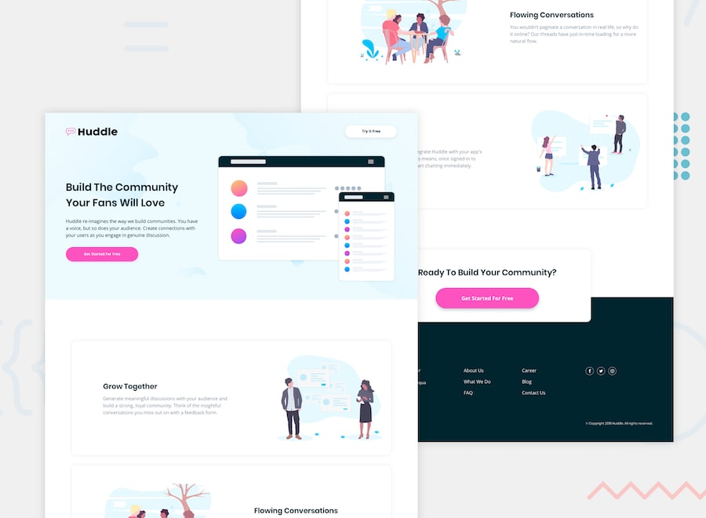

# Frontend Mentor - Huddle Landing Page



## Overview

Це рішення завдання Frontend Mentor для Huddle landing page з чергуючимися блоками функцій. Проект демонструє响應дизайн з правильною мобільною та десктопною версіями, виконаний в стилістиці Kevin Powell.

## 🎯 Завдання

Побудувати посадочну сторінку Huddle за дизайном та забезпечити:

- ✅ Оптимальний макет для різних розмірів екрана (мобіль, планшет, десктоп)
- ✅ Hover-стани для всіх інтерактивних елементів
- ✅ Семантичний HTML та доступність
- ✅ Плавні переходи та анімації

## 📸 Скріншоти

### Мобільна версія (375px)


### Планшет (768px)


### Десктоп (1440px)


## 🛠️ Технологічний стек

- **HTML5** - Семантична розмітка
- **CSS3** - Grid, Flexbox, CSS Custom Properties
- **Responsive Design** - Mobile-first підхід
- **Accessibility** - ARIA labels, semantic elements

## 🎨 Ключові особливості

### CSS Architecture
- **CSS Custom Properties** для кольорів, типографіки та spacing
- **Mobile-First** - базові стилі для мобіля з розширенням
- **BEM-like** naming convention для читаємості

### Responsive Breakpoints
```
📱 Mobile:  < 600px (375px)
📱 Tablet:  600px - 1024px (768px)
💻 Desktop: 1024px+ (1440px)
```

### Color Palette
- Primary Pink: `hsl(322, 100%, 66%)`
- Pale Cyan: `hsl(193, 100%, 96%)`
- Dark Cyan: `hsl(192, 100%, 9%)`
- Grayish Blue: `hsl(208, 11%, 55%)`

### Typography
- **Headings**: Poppins (600 weight)
- **Body**: Open Sans (400, 700 weight)

## 📂 Структура проекту

```
fm-huddle-landing-page-with-alternating-feature-blocks/
├── index.html
├── style.css
├── README.md
├── design/
│   ├── desktop-design.jpg
│   ├── desktop-preview.jpg
│   ├── mobile-design.jpg
│   └── mobile-preview.jpg
├── images/
│   ├── logo.svg
│   ├── illustration-mockups.svg
│   ├── illustration-grow-together.svg
│   ├── illustration-flowing-conversation.svg
│   ├── illustration-your-users.svg
│   ├── icon-communities.svg
│   ├── icon-messages.svg
│   ├── icon-phone.svg
│   ├── icon-email.svg
│   └── favicon-32x32.png
└── style-guide.md
```

## 🚀 Швидкий старт

1. Клонуйте репозиторій або завантажте файли
2. Відкрийте `index.html` у браузері
3. Файли готові до використання без збирання

## 💡 Що я вивчив

### HTML & CSS
- ✅ Семантична розмітка (header, main, article, footer)
- ✅ CSS Grid для складних макетів
- ✅ CSS Flexbox для вирівнювання
- ✅ CSS Custom Properties для систематизації стилів

### Responsive Design
- ✅ Mobile-first методологія
- ✅ Media queries для різних пристроїв
- ✅ Гнучкі одиниці (rem, %)

### Best Practices
- ✅ Доступність (accessibility)
- ✅ Семантичні посилання та кнопки
- ✅ Оптимізована контрастність
- ✅ Плавні переходи

## 🔗 Корисні посилання

- [Frontend Mentor](https://www.frontendmentor.io)
- [Kevin Powell - CSS YouTube Channel](https://www.youtube.com/kepowob)
- [MDN Web Docs](https://developer.mozilla.org)
- [CSS-Tricks](https://css-tricks.com)

## 📱 Live Demo

🔗 [Переглянути сайт](https://your-username.github.io/fm-huddle-landing-page-with-alternating-feature-blocks/)

## 🎬 Дизайн посилання

- [Desktop Design](./design/desktop-design.jpg)
- [Desktop Preview](./design/desktop-preview.jpg)
- [Mobile Design](./design/mobile-design.jpg)
- [Mobile Preview](./design/mobile-preview.jpg)

## ✨ Сніпети коду

### Header структура
```html
<header class="header">
  <div class="container">
    <div class="header__inner">
      <div class="logo">
        
      </div>
      <button class="btn btn--secondary">Try It Free</button>
    </div>
  </div>
</header>
```

### Feature блок з чередуванням
```html
<article class="feature feature--reverse">
  <div class="feature__content">
    <h2 class="feature__title">Grow Together</h2>
    <p class="feature__description">...</p>
  </div>
  <div class="feature__image">
    
  </div>
</article>
```

### CSS Grid для統計
```css
.stats__grid {
  display: grid;
  grid-template-columns: 1fr;
  gap: var(--spacing-2xl);
}

@media (min-width: 37.5rem) {
  .stats__grid {
    grid-template-columns: repeat(2, 1fr);
  }
}
```

## 🐛 Відомі проблеми

Немає актуальних проблем. Проект відповідає дизайну для всіх розмірів екрана.

## 🤝 Внесок

Ви можете форкнути цей проект та запропонувати покращення через pull request.

## 📝 Ліцензія

Цей проект є частиною Frontend Mentor та є безплатним для освітніх цілей.

---

**Автор:** [Ваше ім'я]  
**Дата завершення:** Грудень 2024  
**Frontend Mentor ID:** [Frontend Mentor ID]

**Challenge by** [Frontend Mentor](https://www.frontendmentor.io?ref=challenge)  
**Coded by** [Your Name](https://github.com/your-username)
